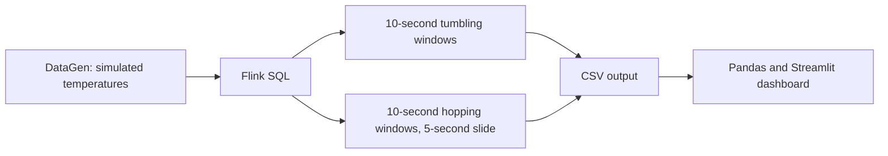

# Real-Time Machine Temperature Monitoring

A **class demo assignment** illustrating real-time stream processing with Apache Flink SQL and Streamlit. The project generates simulated machine temperatures, computes windowed averages, and displays trends and alerts in a local dashboard. It is an educational demonstration, not a production monitoring system.



## Features

- Generates two readings per second for machines 1–3, with temperatures from 60 to 100 °C.
- Computes per-machine averages in non-overlapping tumbling and overlapping hopping windows.
- Displays the latest averages, status counts and sliding-window trends.
- Provides adjustable Warning and High thresholds, on-screen alerts, a machine filter, a window comparison and CSV download.
- Reads completed Flink output files to avoid partially written results.

## Requirements

Docker Desktop with Docker Compose, Python and PowerShell. Start Docker Desktop before running the commands below. The commands assume Windows and the project root as the working directory.

## Run the demonstration

1. Start the Flink cluster:

   ```powershell
   docker compose up -d
   docker compose ps
   ```

   Open the Flink UI at <http://localhost:8081>. The configuration provides one TaskManager with two slots.

2. Submit the continuous SQL job once:

   ```powershell
   docker compose exec jobmanager ./bin/sql-client.sh -f /opt/flink/sql/pipeline.sql
   ```

   Wait for the job to be running and checkpoints to complete. Finished `part-*` files should appear under `output/tumbling` and `output/sliding`. Repeating the submission while the job is running creates duplicate jobs.

3. Install dependencies and start the dashboard:

   ```powershell
   python -m venv .venv
   .\.venv\Scripts\python.exe -m pip install -r requirements.txt
   .\.venv\Scripts\python.exe -m streamlit run dashboard.py --server.address 127.0.0.1
   ```

   Open <http://localhost:8501>. If the dashboard is waiting for results, check that the Flink job is running and has completed a checkpoint. The dashboard reads finished files only.

4. Try the controls. The default Warning and High thresholds are 80 °C and 90 °C. Lower the High threshold below a current average to demonstrate an alert, keeping the Warning threshold below it. Select machines, inspect the trend and comparison, and download the sliding-window CSV. Status is based on the latest sliding average, not an individual reading.

5. Stop the cluster when finished:

   ```powershell
   docker compose down
   ```

   Output remains locally. Submit the SQL job again after restarting the cluster.

## Project files

| Path | Purpose |
|---|---|
| `sql/pipeline.sql` | Data generator, window queries and CSV sinks |
| `dashboard.py` | Streamlit dashboard and extensions |
| `docker-compose.yml` | Local Flink cluster |
| `report.md` | Class report, recorded example results and outstanding evidence |
| `screenshots/README.md` | Suggested screenshots for the assignment |

Generated output and the Python virtual environment are ignored by Git. The Flink UI and the dashboard command above bind to localhost for local use. Avoid exposing this demo to an untrusted network.

## Limitations

The source is simulated, and windows use processing time rather than sensor event time. Averages can hide short spikes. File rolling, checkpointing and dashboard refresh introduce latency; a five-second refresh does not guarantee five-second end-to-end latency. The comparison uses the latest available windows, which may have different time boundaries. Alerts appear in the dashboard only, and output files accumulate without a retention policy.
