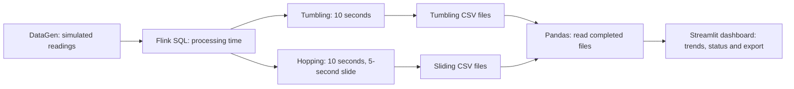

# Real-Time Machine Temperature Monitoring

## 1. Introduction and objectives

Machine temperatures can change continuously, making periodic manual inspection insufficient for timely monitoring. Stream processing provides a way to transform an ongoing flow of readings into summaries as data arrives. This project demonstrates a local monitoring pipeline using simulated machine readings, Apache Flink SQL and a Streamlit dashboard.

The objectives are to calculate per-machine temperature averages using two windowing methods, write the results to CSV files, and present the latest results and trends with adjustable monitoring controls.

## 2. System architecture

The Docker Compose setup runs a Flink JobManager and TaskManager. The JobManager coordinates the job; the TaskManager executes its processing tasks. The SQL statement set sends both aggregations to separate filesystem sinks. The output directory is shared with the host, where Pandas reads finished CSV files and Streamlit displays the results.

## 3. Methodology and implementation

Flink's DataGen connector produces two synthetic records per second. Each record contains an integer machine ID from 1 to 3 and a temperature from 60 to 100 °C. The computed `event_time AS PROCTIME()` field records processing time, so window assignment depends on when Flink processes the record rather than when a physical device measured it.

The SQL pipeline groups readings by machine and window boundaries and calculates `AVG(temperature)`. The tumbling query uses consecutive, non-overlapping 10-second windows. The hopping query uses 10-second windows starting every 5 seconds, so successive windows overlap. Both outputs contain the machine ID, window start, window end and average temperature.

The filesystem sinks roll files periodically, and checkpointing is configured at five-second intervals. The dashboard reads completed `part-*` files, excludes pending and in-progress files, and refreshes every five seconds. It shows the latest averages, a status summary and a sliding-window trend. File completion and checkpointing add latency beyond the dashboard refresh interval.

## 4. Results and testing

Completed output files already in the workspace contain the following recorded results. The readings are synthetic; timestamps are Flink session times. These are examples from different windows and should not be interpreted as a matched comparison.

| Window | Machine | Start | End | Average (°C) |
|---|---:|---|---|---:|
| Tumbling | 3 | 2026-11-06 18:43:40 | 2026-11-06 18:43:50 | 82.0 |
| Tumbling | 2 | 2026-11-06 18:43:40 | 2026-11-06 18:43:50 | 72.0 |
| Hopping | 3 | 2026-11-06 18:43:35 | 2026-11-06 18:43:45 | 78.0 |
| Hopping | 2 | 2026-11-06 18:43:35 | 2026-11-06 18:43:45 | 75.0 |

The rows were read from completed files in `output/tumbling` and `output/sliding`. Their presence demonstrates that both sinks produced output during an earlier run; it does not establish the current job state.

| Check | Evidence or status |
|---|---|
| Both window sinks produced CSV rows | Observed in existing output files. |
| Flink job running and checkpoints completed | Not verified in this review: Docker API access was denied. |
| Dashboard refresh, thresholds and filtering | Awaiting interactive verification. |
| CSV download opens with expected columns | Awaiting interactive verification. |

**Screenshot evidence still required:** No screenshots were present in the workspace. After running the system, add actual images showing the running Flink job and output folders, the dashboard and a triggered alert with thresholds visible, and the downloaded CSV. Record the outcomes of the pending checks above. Suggested filenames and capture guidance are in [screenshots/README.md](screenshots/README.md).

## 5. Extension

The dashboard adds configurable Warning and High thresholds, initially 80 °C and 90 °C. It classifies each machine using its latest hopping-window average: High at or above the High threshold, Warning at or above the Warning threshold, and Normal below it. It displays counts for visible machines and an on-screen alert when a visible machine is High. This is a dashboard message, not an external notification.

A machine selector limits the displayed status, comparison, trend and export to chosen IDs. The comparison table shows the latest tumbling and hopping averages and their difference, calculated as hopping minus tumbling. Since the two latest windows can cover different periods, this difference is descriptive. The user can download the selected machines' processed hopping-window rows as a CSV for further inspection.

## 6. Discussion and conclusion

Tumbling windows provide distinct summaries without overlapping intervals, making successive 10-second periods straightforward to compare. Hopping windows provide a new 10-second summary every five seconds, giving a more frequent view at the cost of overlapping data and additional output. Neither method guarantees a five-second end-to-end response because results must also be written, finalized and read.

The demonstration uses generated data and processing time, so it does not address physical sensor reliability, delayed device events or event-time ordering. An average can also conceal a short temperature spike. CSV files accumulate over time, and the alert requires someone to view the dashboard.

The existing output demonstrates that both windowed aggregations have produced per-machine results. The implementation connects those results to a dashboard with status, filtering, comparison and export; screenshots and interactive checks remain necessary to document those features in operation.
